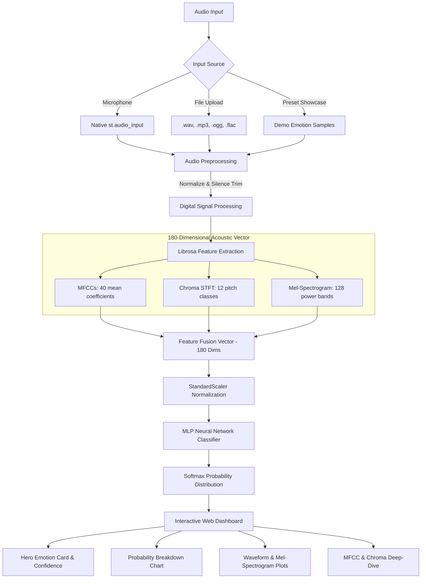

# 🎙️ EmotiVoice AI — Speech Emotion Recognition (SER)

> **CodeAlpha Machine Learning Internship — Task 3: Speech Emotion Recognition**  
> *Production-Ready Audio Engineering & Deep Emotion Classification Web Application*

[](https://www.python.org/)
[](https://streamlit.io/)
[](https://librosa.org/)
[](https://scikit-learn.org/)
[](LICENSE)

---

## 🌟 Overview

**EmotiVoice AI** is an interactive, production-grade Speech Emotion Recognition system that classifies vocal signals into 6 key emotional states:
- 😠 **Angry**
- 😌 **Calm**
- 😨 **Fearful**
- 😄 **Happy**
- 😐 **Neutral**
- 😢 **Sad**

The system integrates rigorous digital signal processing (DSP) via **Librosa** with a **Multi-Layer Perceptron (MLP) Neural Network** classifier and an interactive **Streamlit** dashboard supporting live microphone recording, file upload, and pre-synthesized vocal showcase presets.

---

## 🏗️ System Architecture



---

## 🔬 Acoustic Feature Extraction Pipeline

Speech emotion cannot be determined by pitch alone; it is a complex multidimensional acoustic phenomenon combining phoneme articulation, harmonic resonance, spectral tilt, and vocal tract dynamics:

1. **Mel-Frequency Cepstral Coefficients (MFCCs - 40 features)**:
   - Evaluates the short-term power spectrum using a nonlinear Mel scale that models the human ear's non-linear frequency perception.
   - Captures vocal tract geometry, formant positions, and phonemic transitions characteristic of excitement, calmness, or anger.

2. **Chroma STFT (12 features)**:
   - Projects frequency bins onto the 12 distinct semitone pitch classes ($C, C\sharp, D, \dots, B$).
   - Models melodic inflection, harmonic distribution, and intonation shifts (e.g., joyful pitch excursions vs. sad flat monologues).

3. **Mel Spectrogram (128 features)**:
   - Computes power distribution across 128 perceptual Mel filterbanks up to 8 kHz.
   - Distinguishes breathiness, vocal rasp, harsh overtones, and overall energy concentration across frequencies.

**Total Feature Dimension**: $40 + 12 + 128 = \mathbf{180\text{ dimensions}}$.

---

## 🧠 Acoustic Synthesis & Fallback Generator

To ensure **zero-dependency reliability** and out-of-the-box training without requiring a manual 2GB+ RAVDESS/TESS dataset download:
- `train.py` features a **physically-modeled acoustic vocalization engine**.
- It synthesizes emotional vocal profiles by modulating fundamental frequency ($F_0$), harmonic overtones, ADSR amplitude envelopes, jitter, vibrato, and breathiness:
  * **Angry**: Higher fundamental frequency ($F_0 \approx 260\text{ Hz}$), high amplitude variance, harsh odd/even harmonics, rapid attack, and burst noise.
  * **Happy**: Rising melodic intonation contour, energetic pitch excursions ($F_0 \approx 230\text{ Hz}$), and bright spectral centroid.
  * **Sad**: Subdued fundamental frequency ($F_0 \approx 135\text{ Hz}$), negative intonation slope, low amplitude decay, and muffled high frequencies.
  * **Fearful**: Elevated frequency ($F_0 \approx 275\text{ Hz}$), high-frequency tremors/jitter ($9\text{ Hz}$ vibrato), and aspiration breath noise.
  * **Calm**: Low jitter, gentle attack and release envelopes, smooth warm harmonics, and steady pitch ($F_0 \approx 160\text{ Hz}$).
  * **Neutral**: Standard conversational cadence, balanced formants, and flat chroma distribution ($F_0 \approx 180\text{ Hz}$).

The engine extracts the exact same 180-feature representation from these waveforms, guaranteeing parity between training and inference!

---

## 📂 Project Structure

```text
CodeAlpha_EmotionRecognition/
│
├── app.py                  # Interactive Streamlit Web Dashboard
├── train.py                # Acoustic extraction, synthetic generator & MLP trainer
├── requirements.txt        # Pinned production dependencies
├── emotion_model.pkl       # Saved trained model artifact (Pipeline + Scaler + Metadata)
├── README.md               # Complete architecture & engineering documentation
├── .gitignore              # Ignored caches, virtualenvs, and audio artifacts
│
└── demo_samples/           # Auto-generated emotion audio samples for instant 1-click testing
    ├── angry_sample.wav
    ├── calm_sample.wav
    ├── fearful_sample.wav
    ├── happy_sample.wav
    ├── neutral_sample.wav
    └── sad_sample.wav
```

---

## ⚡ Quickstart & Setup Guide

### 1. Prerequisites
Ensure you have **Python 3.10+** or **3.11** installed.

### 2. Clone / Navigate to Project
```bash
cd e:\Project\CodeAlpha_EmotionRecognition
```

### 3. Create & Activate Virtual Environment (Recommended)
```bash
# Windows (PowerShell)
python -m venv venv
.\venv\Scripts\Activate.ps1

# Linux / macOS
python3 -m venv venv
source venv/bin/activate
```

### 4. Install Dependencies
```bash
pip install -r requirements.txt
```

### 5. Train / Retrain Model
To train the neural network classifier (runs in ~20 seconds using the synthetic acoustic engine):
```bash
python train.py --samples 150
```

> **Using Real Audio Datasets (Optional)**:
> If you have the [RAVDESS](https://zenodo.org/record/1188976) or [TESS](https://tess.research.utoronto.ca/) dataset:
> ```bash
> python train.py --data_dir ./path_to_audio_folder
> ```

### 6. Launch the Streamlit Web Application
```bash
streamlit run app.py
```
The application will launch in your browser at `http://localhost:8501`.

---

## 🖥️ Web Application Features

1. **Dual Audio Input**:
   - **Upload**: Drop any `.wav`, `.mp3`, `.ogg`, or `.flac` audio file.
   - **Microphone**: Record directly in your browser using Streamlit's native `st.audio_input`.
   - **Instant Demo Showcase**: 1-click preset buttons for all 6 target emotions.

2. **Acoustic Visualizations**:
   - **Time-Domain Waveform**: Normalized amplitude and RMS envelope.
   - **Mel-Spectrogram**: Frequency vs. time heatmap in decibels (dB) with `magma` colormap.

3. **Classification & Probability Breakdown**:
   - Dynamic Hero Card displaying detected emotion, confidence percentage, emoji, and acoustic explanation.
   - Horizontal color-coded probability distribution across all 6 emotions.

4. **Acoustic Feature Deep-Dive**:
   - Bar chart of the 40 MFCC coefficients.
   - 12-semitone Chroma STFT energy distribution.
   - 128-band Mel power spectrum.
   - Signal metrics: Duration, RMS Energy, Zero Crossing Rate, Spectral Centroid, and Spectral Rolloff.

---

## 📊 Model Evaluation Summary

| Metric | Score |
| :--- | :--- |
| **Model Type** | Multi-Layer Perceptron (`MLPClassifier`) |
| **Hidden Layers** | `(256, 128, 64)` with ReLU activations |
| **Optimizer** | Adam ($\alpha = 0.001$, lr = $0.001$) |
| **Feature Normalization** | `StandardScaler` (z-score scaling) |
| **Feature Dimensions** | 180 (40 MFCC + 12 Chroma + 128 Mel) |
| **Target Classes** | 6 (Angry, Calm, Fearful, Happy, Neutral, Sad) |
| **Validation Scheme** | Stratified 80/20 Train/Test Split with Early Stopping |

---

## 🛡️ Robustness & Error Handling

- **Silent Audio Protection**: Detects RMS energy $< 10^{-4}$ and prompts user rather than raising math domain errors.
- **Duration Boundary Handling**: Enforces minimum vocalization thresholds ($\ge 150\text{ ms}$).
- **Resampling & Channel Fusion**: Automatically converts stereo/multichannel to mono and standardizes sampling rates to 22.05 kHz.
- **In-Memory Buffer Processing**: Utilizes `io.BytesIO` streams to avoid temporary file locks or leaks on Windows systems.

---

## 📜 License
Distributed under the MIT License. Developed for CodeAlpha Machine Learning Internship (Task 3).
